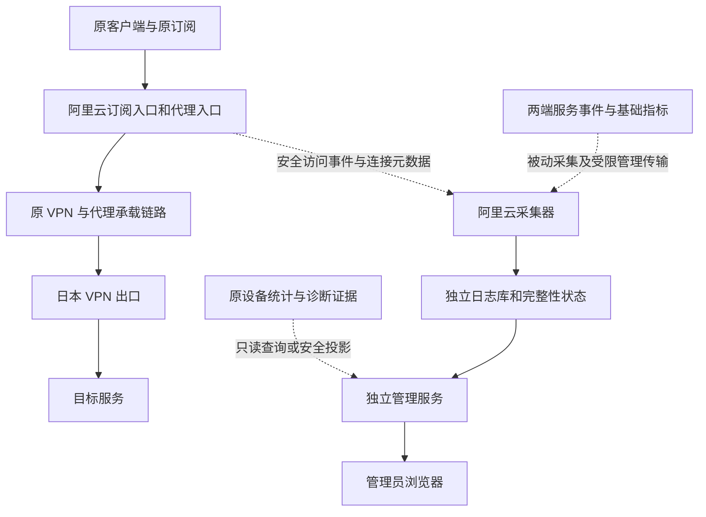

# Wayvia 日志系统与管理员平台开发方案

Status: implemented_software_verified
Scope: repository_and_software_validation_only
更新日期：2026-10-27，America/Los_Angeles

阅读建议：先看第 1–2 节确认功能范围，第 9 节看平台怎么使用，第 12–14 节看开发顺序、验证和部署；其余章节供实施时核对技术细节。

## 1 要交付什么

为 Wayvia 增加一个只有管理员使用的网页平台。管理员可以查询订阅访问与限流、设备连接目标与流量、服务器和服务异常、管理操作，以及日志有没有漏采。家人朋友继续使用原有订阅链接，操作仍然只有导入订阅和启用客户端。

本方案已完成仓库实现和软件验收，见[使用与运维](../../docs/logging-admin.md)及[验收记录](../../docs/validation/logging-admin-2026-10-27/README.md)。开发、隔离验证、生产部署分别验收；本轮不连接生产服务器、不部署、不恢复已停止的诊断或通知任务。下文生产步骤仍为未来操作设计。

### 管理员最终能回答的问题

| 问题 | 平台给出的答案 |
| --- | --- |
| 现在连接是否正常 | 已有链路健康证据、证据时间、两端服务状态；没有新鲜证据时显示未知 |
| 今天有多少请求被限流 | 当前筛选范围内已记录的限流请求数、速率或并发原因、来源 IP 和时间，并显示日志覆盖情况 |
| JXY 用了多少流量 | 现有设备累计量和分钟、小时历史，保持原有统计口径 |
| JXY 连接过什么目标 | 每条可观测代理连接的时间、目标域名或 IP、端口、持续时间及上下行字节 |
| 谁来请求订阅 | 来源 IP、请求类别、状态；认证成功后关联订阅和设备，认证前拦截显示账号未知 |
| 为什么某次使用出问题 | 同一时间段的设备连接、订阅请求、服务异常和已有诊断证据，区分事实与可能关联 |
| 管理员改了什么 | 操作主体、动作、对象、提交时间、实际结果及可关联的任务或修订 |
| 为什么这段时间没有记录 | 明确区分没有事件、未启用、采集中断、超出保留期、容量不足和来源不可用 |

“连接过目标”表示使用某设备凭据建立过对应连接，不能直接解释成用户主动打开网页、看了某条视频或发送了某条消息。示例和测试一律使用合成数据。

### 用户体验必须保持的条件

- 原订阅 URL、令牌、有效期、设备 ID、代理密码、订阅名称、节点与分组名称保持不变。
- 原有客户端配置、分流规则、DNS、证书校验、更新间隔和导入方式保持不变。日志功能不要求重新导入，也不要求用户更新订阅才能生效。
- 国内与本地资源继续在终端直连；代理业务继续遵守 VPN-over-proxy 顺序和 fail-closed 规则。
- 原有数据、发布快照、撤销记录、流量累计值和凭据恢复检查点保留；升级不会复活已撤销账号。
- 管理平台、日志采集或日志存储故障，不成为代理转发和订阅下载的新依赖。

## 2 本次范围与明确边界

### 必须实现

1. 订阅入口的安全结构化访问日志、速率与并发限制结果。
2. 按设备凭据归属的代理连接明细，包含可获得的来源和目标信息。
3. 两端 Wayvia 服务事件、主机基础指标、SSH 认证事件，以及既有管理操作审计的查询。
4. 日志采集状态、缺口、保留期限、资源上限和采集故障提示。
5. 私有管理员登录、总览、设备详情、订阅请求、服务器事件、操作记录、筛选和脱敏导出。
6. 在保留旧数据和原订阅的前提下安装、升级、停用与回退。
7. 正常行为回归、隔离环境验收、资源影响对照，以及独立的部署验收清单。

### 本次不实现

| 内容 | 原因或边界 |
| --- | --- |
| HTTPS 正文、完整网页路径、搜索词、聊天内容 | 终端保持现有信任设置时，服务端转发不能解密第三方 HTTPS；不引入中间人证书或客户端采集程序 |
| 明文 HTTP 的业务正文与任意抓包归档 | 本期也只保存连接元数据，避免因协议不同而意外采集内容 |
| 国内直连流量与所有手机应用操作 | 这些流量可能根本不经过 Wayvia；没有终端进程、屏幕或操作采集能力 |
| 完整的人或物理设备识别 | 一个凭据可能被多人或多设备共用；NAT、移动网络和 IP 归属不能证明人的身份或精确位置 |
| 所有服务器端口及其他应用的完整审计 | 默认只接入指定 Wayvia 站点、组件和基础主机安全来源；其他 Nginx 站点、容器、应用需单独列入范围 |
| 每条 SSH 命令、文件内容和不可篡改取证 | SSH 登录记录不等于完整操作录屏；拥有 root 权限的人仍可能改动本机日志 |
| 自动封禁、自动调整限流、自动重启和自动恢复 | 本期提供事实、告警和手动管理入口，保持现有恢复与网络保护语义 |
| 外部消息推送、公开管理员入口、多租户与计费 | 平台内提示先交付；外部接收人、渠道和公网入口另行配置与授权 |

过去没有保存的目标访问明细和限流事件不能补造。每类日志显示实际开始时间与最早可查询时间。

## 3 已有实现与需要扩展的位置

本方案基于 `codex/probe-observer-evidence`，提交 `c98141f83668182733e0989a7b0d54a461adff39` 及当前工作区已有改动。工作区包含先前完成的限流与产品范围文档，实施时应先重新核对分支、文件差异及部署版本，不能直接假设生产运行此提交。

| 现有基础 | 当前行为 | 本期处理 |
| --- | --- | --- |
| [原生统计适配器](../../src/wayvia/adapters/singbox/usage.py) | sing-box 1.14.3、API 4；只取身份、时间和计数，取完初始快照即取消流 | 新增连接事件通道，保持旧统计接口及字段语义 |
| [设备统计](../../src/wayvia/services/usage.py)与[历史统计](../../src/wayvia/services/usage_history.py) | 每 5 秒采集；高水位去重，记录重启和缺测 | 继续作为设备总量来源，新明细不重复入账 |
| [HTTP API](../../src/wayvia/api/__init__.py) | 有请求 ID、管理鉴权、订阅与历史接口，没有完整访问事件 | 增加安全事件投递与独立管理查询接口 |
| [控制面存储](../../src/wayvia/storage/__init__.py) | schema 4；包含设备、订阅、统计与 audit | 保留原数据，查询不触发迁移；日志主体进入独立数据库 |
| [诊断与告警](../../src/wayvia/telemetry/) | 有界诊断、双端事件、缺测、导出、独立告警评估 | 复用证据语义和可复用查询逻辑，不自动续期旧 run |
| [订阅限流](../../deploy/subscription_limits.py) | 每来源 5r/m、burst=5、全局并发 2，拒绝返回 429 | 保持阈值与行为，只新增可区分原因的观测 |
| 管理界面 | 当前没有交付本方案所需的网页控制台 | 新增本地静态资源、会话登录和页面 |

上游原生连接对象已有 `user`、`source`、`destination`、`domain`、创建/关闭时间、上下行累计值；对应实现会从连接元数据填充这些字段。协议定义支持该能力，不等于当前真实客户端一定能提供所有字段。开发第一阶段必须用锁定核心与合成设备验证字段可用性。[sing-box 原生协议](https://github.com/SagerNet/sing-box/blob/v1.14.3/daemon/started_service.proto)、[连接事件实现](https://github.com/SagerNet/sing-box/blob/v1.14.3/daemon/started_service.go)

### 与既有设计的关系

- [ADR 007](../../docs/adr/007-device-usage-observations.md)和[ADR 010](../../docs/adr/010-device-history-and-observation-alerts.md)原先禁止保存来源和目标信息。本次用户明确提出连接记录，已新增 [ADR 013](../../docs/adr/013-private-traffic-metadata-and-admin.md)，允许在私有日志库中保存有期限的来源与目标元数据；密码、令牌和正文仍不采集。不能只改适配器而留下相反的设计约束。
- [ADR 008](../../docs/adr/008-observation-evidence-and-lifecycle.md)、[ADR 009](../../docs/adr/009-rolling-diagnostics-and-incident-export.md)的原有诊断 run、最长租期、停止与证据规则继续有效。长期被动日志采用独立生命周期，见第 8 节。
- [原安全 TODO](../subscription-security/TODO.md)和[产品 TODO](../product-scope/TODO.md)中的“不做目标历史”已被本次需求调整；已更新这些范围说明，并将对应安全观测事项关联到本功能，避免两份任务重复实现。
- 本期不重新定义设备撤销、订阅撤销、配置发布或故障恢复；沿用现有接口语义。

## 4 总体架构

业务链路保持原状。观测从各组件已有接口或结构化输出旁路读取，不接管业务流、不引入 HTTPS 解密代理。



图中的订阅下载与代理连接是两类独立事件，实际部署仍为不同端点。图不表示订阅请求会经过日本，也不表示国内直连流量进入上述链路。

### 进程和权限分工

| 组件 | 职责 | 权限与失败边界 |
| --- | --- | --- |
| 原订阅 API、代理核心、VPN | 继续服务原用户 | 不等待日志数据库、远端采集或管理页面 |
| 本机事件适配层 | 从原生核心、指定 journal 与应用事件产生白名单记录 | 核心 API 密钥留在特权边界内；不提供任意命令、URL、文件读取或核心控制代理 |
| 阿里云日志采集器 | 接收、校验、去重、批量入库、维护缺口 | 独立低权限服务，单写入者，有界队列；故障仅降级观测 |
| 日本被动采集器 | 指定服务、主机指标和自身完整性，写本地有界待传文件 | 独立权限；不承诺可从出口直接识别 JXY |
| 管理传输器 | 传输日本已脱敏批次到阿里云 | 独立低权限进程、固定主机与命令、主机密钥校验；断网可重试，不操作业务服务 |
| 管理服务 | 会话鉴权、日志查询、导出、已有管理能力的受限调用 | 仅监听回环接口；日志库只读；与公开订阅处理分进程、分连接池、分资源限额 |
| 独立完整性检查 | 比较心跳、读取错误和存储状态 | 不依赖采集循环能否正常执行；平台关闭时不承诺外部通知 |

日志用户不得获得数据库中的设备秘密或服务器私钥。原生连接接口由受限适配层投影后输出；不把 `127.0.0.1:19090` 发布给浏览器。

## 5 每类日志如何采集

### 5.1 订阅访问和限流

Nginx 是 HTTP 请求计数的主来源。API 事件补充认证后的设备与订阅身份、业务错误码；两者按同一请求 ID 合并，一次请求只计一次。

拟保留：发生时间、请求 ID、实际来源 IP、HTTP 方法枚举、路由类别、配置格式、HTTP 状态、响应字节、总耗时、可用时的上游耗时、限流模块结果、已认证的设备与订阅 ID。

路由类别只允许 `subscription_download`、`subscription_info`、`health`、`management_denied`、`unknown_path` 等固定值。日志不包含原始请求行、完整 URL、原始路径、query、Referer、Cookie、Authorization、订阅正文或原始 User-Agent。不能先记录原文再在页面隐藏。未知路径只记录类别，不保存扫描者提交的任意字符串。

Nginx 已提供 `$limit_req_status` 和 `$limit_conn_status`，分别表达请求速率与并发限制结果。实现时记录两个独立值，再生成原因；只看到 429 而模块结果不足时，标记 `unknown_429`，不能推断成某个限流规则。`REJECTED_DRY_RUN` 不计入实际拒绝，模块未执行保持未适用。[速率限制变量](https://nginx.org/en/docs/http/ngx_http_limit_req_module.html#var_limit_req_status)、[并发限制变量](https://nginx.org/en/docs/http/ngx_http_limit_conn_module.html#var_limit_conn_status)

身份与关联规则：

- Nginx 生成请求 ID，并覆盖转交后端的对应请求头；不信任外部自带请求 ID。后端仅在经过预设可信回环代理入口时使用该 ID，其他本地调用自行生成。
- 使用当前 Nginx 实际连接来源；不因记录日志而开启任意 `X-Forwarded-For` 信任。后续增加 CDN 时必须单独配置可信代理和重新验收。
- 认证成功后，API 事件使用数据库中的稳定设备与订阅 ID。无效链接、Nginx 提前拒绝和无法关联的请求保持身份未知，不能按 IP 或链接外观猜测 JXY。
- 后端不向外部响应泄露内部账号 ID；关联信息通过本地事件通道传递。
- 后端错误和 Nginx 拒绝分别归因。客户端中止、上游超时与订阅无效不能混为攻击。

安全日志传输拟使用 Nginx 自定义 JSON 格式、经本机 Unix datagram 接收器进入有界队列；接收器先持久化短期待处理文件，再批量入库。应用也采用有界、失败可返回的本地事件投递。开发阶段验证接收器停机、权限错误和队列满载时 Nginx/API 不等待。该通道是尽力投递，可能丢失；计数以已收到的请求为准，缺口单独展示，不能宣称精确计费或零丢失。[Nginx 日志格式和输出](https://nginx.org/en/docs/http/ngx_http_log_module.html)

保持 Uvicorn 原始访问日志关闭；不直接打开包含令牌路径的 Nginx 默认错误日志。限流原因来自安全字段，详细 API 错误来自枚举事件。Nginx 主进程已有全局错误输出也须检查是否含本虚拟主机请求，敏感性验收不局限于新增文件。

### 5.2 设备代理连接

采集点选在阿里云完成设备认证后的入口。按 `(host_id, core_epoch, connection_id)` 唯一定位连接，将原生 `user` 映射为已存在的设备 ID；内部探针与未知凭据不计入普通设备历史。

新增持续连接事件读取：启动时获取初始状态，之后消费新建、计数更新和关闭事件；每 5 秒保存有变化的累计计数，关闭时保存可得的最终值。旧 `wayvia-usage` 仍保持自己的 5 秒统计与原有水位，不能让两个采集器共同更新原统计表。

新增通道不得长时间占用现有串行 agent 请求处理器。实现采用独立受限本地事件端点或单独事件工作进程，保持现有恢复、状态和凭据同步调用可用；断开慢客户端、限制消息及队列大小，不让采集器反压到核心。原生 API 没有完整持久事件重放保证，重连仅对可恢复快照补齐并记录缺口。

| 字段 | 页面含义与约束 |
| --- | --- |
| device_id、identity_source | 凭据身份；不自动升级为已确认物理设备或人 |
| source_ip、source_port | 入口观察到的地址；可能是 NAT 地址，不是手机内网地址 |
| target_host、target_ip、target_port | 按来源分别保存；目标可能只有域名或只有 IP，不为补字段额外发 DNS 请求 |
| domain_source | 协议提交、已存在的核心识别或未知；不把反向 DNS 猜测当原始目标 |
| transport、application_protocol | TCP/UDP 与已识别协议分开；不能识别的应用协议为空 |
| created_at、closed_at、last_observed_at | 原生连接时间与采集时间分开；首次快照中的旧连接标注开始证据不完整 |
| upload_bytes、download_bytes | 该连接的核心累计值；不等于网卡流量或网站收到的字节 |
| lifecycle、end_reason | 活跃、已关闭、状态未知；核心没有关闭原因时保持未知，不把正常关闭写成失败 |
| coverage、uncertainty | 重连、核心重启、计数异常、关闭缓存不足等已知限制 |

不通过修改客户端 DNS、开启新嗅探规则、增加目标探测或降低 TLS 校验来补全域名。一个加密连接可能承载多个 HTTP 请求，界面不能称其为“访问请求列表”。界面保留“订阅 HTTP 请求”和“代理连接”两个清晰名称。

目标连接总量与设备统计可能因采样窗口和丢失不同而有差异，页面并列说明口径，不强行把两者凑平。连接发生在共享 VPN 之上时，日本端证据默认归属共享链路；没有可靠映射就不关联到 JXY。

### 5.3 服务器、认证与管理操作

接入范围包括 Wayvia 入口、出口、carrier、bridge、VPN、agent、API、usage、已有 monitor/recover 单位，以及本期新增日志和管理单位。基础指标包括 CPU、可用内存、磁盘可用空间、选定接口计数及采集自身开销。接口计数是主机或接口口径，不归算给某台设备。

使用 journal 游标和固定服务白名单。SSH 仅收集可解析的成功/失败认证事件、来源 IP、目标账号与认证方式；账号和来源按受限字段存储，不记录命令、环境变量或认证秘密。旧 journal 可能含原始请求或秘密，解析必须先投影再入库；未知文本只计解析失败，不将任意 `MESSAGE` 传到平台。

原生核心的连接事件不提供完整错误语义；连接错误需要单独的已验证结构化或固定格式日志适配。无法可靠关联连接 ID 时，保留为同时间段组件事件，不伪造连接级原因。认证失败在凭据尚未确认前属于未知设备。

管理事件复用既有 audit，新增平台事件包括登录、退出、导出、日志策略变更、告警确认及设备/订阅管理动作。已有 `local-admin` 历史不回填成新会话用户。写操作区分已提交、执行中、已生效和失败；失败也应留下安全原因码。

平台发起的管理写操作先持久化操作意图和幂等标识，审计存储不可用时拒绝这次管理动作并解释原因。执行结果通过原有任务/状态查询核对，结果记录失败时显示待核实，不盲目重复执行。此要求仅针对新增管理操作，不使日志故障影响普通用户的订阅下载或代理使用。

### 5.4 两端传输

日本端只传已投影的数据，禁止传原始 journal、数据库秘密表或整机文件。默认由阿里云的独立传输进程通过固定 SSH 管理通道拉取有界批次：专用密钥、固定主机密钥、服务器 forced command、禁止端口/agent/X11 转发，远端命令只能读取指定导出队列。不能复用带任意 root shell 权限的个人密钥作为常驻采集凭据。

批次包含来源身份、schema、生产者代次、连续序号、时间范围和摘要。中心持久化后才确认；重复批次幂等，断点与确认号持久化。来源身份由已验证的传输通道确定，文件里的 host_id 不是身份认证。摘要只能检查一致性，不能替代通道认证。

传输默认每 30 秒执行有界同步，退避后不积累并发任务。积压到期或容量耗尽时记录丢失区间与数量可知性；不能无限占用日本磁盘，也不能因此停止 VPN。双端时间以 UTC 保存，时钟未知时保留未知；时间相近只提供排查线索。

## 6 数据模型与查询契约

### 公共字段

新日志采用独立 `log_schema_version=1`。可用的证据沿用现有公共字段的原意：`event_id`、`observed_at`、`monotonic_ms`、`role`、`revision`、`generation`、`run_id`、`boot_id`、软件版本及时间同步信息。新增 `received_at`、`host_id`、`source`、`source_epoch`、`source_sequence`、`event_kind`、`severity`、`identity_source` 和 `uncertainty`。

不能把核心启动时间强塞进原有 32 位 generation 字段；核心代次另存 `core_epoch`。长期日志的 `collector_instance_id` 与有限诊断的 run_id 分开。未知 revision/generation 保持空值，不用当前发布版本覆盖历史。

旧证据 v1、旧数据库和旧导出格式不被重新解释。目标元数据使用新受限模型，不能绕过旧脱敏器，也不能顺便进入原本不含目标的历史证据包。

### 拟新增存储

| 存储 | 内容 | 关键约束 |
| --- | --- | --- |
| `observability.db` | HTTP 请求、代理连接、系统事件、来源状态、缺口和有限聚合 | 独立迁移；采集器单写，管理查询只读，不外键依赖控制库 |
| `admin-state.db` | 会话摘要、一次性登录码摘要、告警确认、导出任务和管理审计 | 与公开订阅库隔离；不保存管理 bearer 明文 |
| 本地待传目录 | 已投影的尚未确认批次 | 私有权限、幂等序号、有容量和时间上限 |
| 导出目录 | 有明确筛选范围和到期时间的脱敏包 | 与数据库预算分开；下载需要会话，不是可转发公开链接 |
| 原 `metadata.db` 与诊断库 | 原设备、订阅、流量及诊断事实 | 本期不重新计算累计量，不导入真实目标到旧格式 |

逻辑表至少包含 `http_requests`、`proxy_connections`、`system_events`、`source_checkpoints`、`coverage_gaps`、`request_rollups`；管理状态包含 `admin_sessions`、`admin_audit`、`export_jobs`、`alert_acknowledgements`。表和迁移版本在实现时确定，不在现有 schema 4 上无差别增加高频明细写入。

去重分别使用可信入口请求 ID、核心代次与连接 ID、journal 来源与游标、已认证批次的来源与序号。恢复已提交数据不能增加第二份统计。每批数据和对应消费水位在同一事务提交，崩溃后允许重放。遇到计数回退或未知终止时间，保留异常标记，禁止产生负流量。

### 读取规则

- 默认查询最近 1 小时；明细单次最多 24 小时，分页 100 行、上限 500 行；使用有界游标分页，不提供任意 SQL、正则或无限全文搜索。
- 支持时间、设备、角色、来源 IP/CIDR、目标域名/IP、端口、状态和固定事件类别。IP/CIDR 和域名严格解析，限制输入长度；域名搜索默认规范化精确或后缀匹配。
- 聚合支持保留期内按日/小时查询，统计附带 `as_of`、范围、覆盖信息、是否截断及最早可用时间。数据库限制中断查询时明确返回错误，不显示完整结果。
- 域名与 IP 均视为不可信内容，编码显示，不自动访问目标、不下载图标、不发送到第三方归属查询服务。
- 地理位置首期仅以来源 IP 查询为必需；若增加国家/ASN，使用本地离线数据库并注明版本和估算，不显示“真实住址”。

## 7 容量、保留与性能控制

先按少量私人设备和现有小规格入口设计。以下数字是开发起点与验收预算，不是测得的生产容量或承诺；完成隔离对照后可以收紧并记录理由。

| 数据 | 默认保留 |
| --- | --- |
| 代理连接目标与来源明细 | 7 天 |
| 订阅访问、限流与 SSH 认证明细 | 14 天 |
| 系统事件与日志缺口 | 30 天 |
| 管理操作审计 | 90 天 |
| 不含目标或来源 IP 的按日请求汇总 | 90 天 |
| 设备分钟/小时流量 | 沿用原有 30 天 / 365 天，不另建目标长期画像 |
| 本期服务器生成的导出文件 | 最长 24 小时；下载后副本需管理员自行保管和删除 |
| 未确认远端批次 | 最长 24 小时，同时受容量上限约束 |

查询即时执行保留期过滤，后台清理物理删除过期记录。活跃长连接的旧明细按相同期限滚动处理，不能因始终未关闭而永久保留目标信息。敏感聚合和索引遵守同一期限，备份须单列保留；删除不宣称能擦除磁盘快照或已下载副本。

超出保留窗口的活跃连接仅保留当前窗口片段及计算本窗口增量所需的计数基线，标记为“连接在窗口前已开始”；不把片段重开计为一次新的网络连接。原设备累计量仍由旧统计维护。

每台主机设置有界存储；阿里云新增观测与管理文件的初始总预算 1 GiB：日志数据库数据页 256 MiB、最坏回滚日志预留 256 MiB、本地待处理批次 64 MiB、管理状态及其日志共 64 MiB、导出 128 MiB，其余 256 MiB 用于临时文件和安全余量。数据库页数预算已经包含其索引，不再额外给索引重复额度。日本待传文件初始上限 64 MiB，基础指标/事件及回滚空间另限 64 MiB。原控制数据和旧诊断库不属于可删除的腾挪对象。

新数据库先采用短事务、单写者与 DELETE journal，按页数限制数据文件并预留回滚空间，沿用旧诊断库易控制容量的思路。查询默认 2 秒预算、最多 2 个并发；导出按块读，不持有长读事务。若实测读写争用不可接受，再通过 ADR 改为 WAL 并验证 checkpoint 和总文件上限；WAL 不等于无限并发或天然有界。[SQLite 并发与 WAL 限制](https://www.sqlite.org/wal.html)

主机可用磁盘低于 `max(2 GiB, 文件系统容量的 10%)` 时停止新导出和新明细持久化，优先保留小型完整性状态；清理仅覆盖本功能已经过期的数据。容量不足而尚有未过期数据时标记降级和缺口，不静默缩短保留期，不删除控制数据，不阻断代理业务。

初始资源目标：入口新增采集、管理和传输进程合计常驻内存不超过 192 MiB，所属 systemd slice 设置 256 MiB 总上限；稳态 CPU 不超过单核 10%，单次批量事务不超过 200 条或 1 秒周期。每来源内存队列最多 4096 条且不超过 8 MiB，单事件不超过 4 KiB；任何一个上限先到即执行溢出策略。限制子进程数量、导出并发和重试频率，避免 OOM 影响原服务。

溢出时按来源保留生命周期/缺口状态，合并可合并的计数更新，拒绝新的低优先级明细并累计可知的丢失数量。无法知道丢失条数时记为未知，不能填 0。观察故障采用“业务继续、观测降级”；这与原受保护业务禁止直出的 fail-closed 规则是两种不同的边界。

## 8 生命周期、完整性与告警

本期新增长期被动日志策略，安装后默认未启用；未来部署时显式设置 `desired_enabled=true`，记录策略修订、启用者、时间和采集范围。服务重启只恢复仍处于启用状态的这份策略。管理员停用必须先持久化意图，之后 systemd 重启或升级不能把它重新启用。

旧诊断任务仍受原 run 的截止时间、最长租期、generation 和 stop 约束。新日志服务不得自动重开旧 run、延长原期限、触发主动探测或恢复旧 heartbeat。对长期日志和有限诊断分别编写生命周期测试，并在新 ADR 中解释区别。

每个来源显示：是否启用、最后成功事件/轮询时间、最后心跳、消费水位、积压、解析失败、可知的丢失数、缺口区间、最早可用时间。没有业务事件时仍应有独立心跳；“零条新事件”不能被当成采集器存活证据。

本机来源默认 20 秒未更新心跳显示过期；日本传输默认 90 秒未成功显示过期。阈值只用于来源新鲜度，不定义业务离线。核心事件流发生重连时，即使初始快照补齐部分连接，也保留无法证明覆盖完整的区间；Unix datagram 的不可证明投递情况明确说明。

首期在平台内展示三类提醒：

| 类别 | 触发与恢复 |
| --- | --- |
| 已有业务健康异常 | 复用新鲜的健康/恢复证据；进程 active 或没有新日志不能解除异常 |
| 观测不完整 | 来源中断、积压到期、存储失败、数据被截断、证据过期；来源恢复后关闭提醒，但保留历史缺口 |
| 请求与认证异常增长 | 展示时间窗、实际计数、规则阈值和来源；默认只提示，不自动封禁或给请求者贴“攻击者”标签 |

同一原因去重，持续异常更新同一个事件。管理员“已知晓”与系统“已恢复”分开。平台或服务器全部离线时，浏览器只能报告不可达；外部通知与独立外部可用性监控不在首期默认启用范围内。

## 9 管理员平台的页面与使用流程

平台面向一名统一管理服务的管理员。默认中文，桌面优先，手机浏览器可以查状态和事件。页面以故障定位和记录查询为主，技术细节在展开后出现，避免把大量指标堆成难理解的首页。

### 页面结构

| 页面 | 首屏回答什么 | 主要内容与操作 |
| --- | --- | --- |
| 总览 | 现在有没有需要处理的事 | 业务健康与更新时间、日志完整性、两端状态、当前待处理事件；进入设备或故障时间段 |
| 设备与订阅 | 某个账号正在使用什么、用了多少 | 设备列表、现有累计/历史流量、原订阅状态；进入连接记录和订阅拉取历史 |
| 订阅请求 | 谁来请求、是否成功、为什么被拦截 | 来源、请求类别、状态、速率/并发原因、已认证账号、时间与耗时 |
| 服务器与故障 | 问题发生在哪一端、哪个组件 | 两端资源与服务事件、SSH 认证、已有健康证据、统一时间线与证据来源 |
| 管理操作 | 谁做了什么、是否实际生效 | 登录、设备/订阅操作、配置变化、导出和策略变更；显示提交与最终结果 |
| 日志设置 | 记录什么、保存多久、有没有漏采 | 来源启停、策略版本、容量、保留期、心跳、缺口及清理状态 |

告警以总览待处理列表和各相关页面状态出现，不再增加一个没有上下文的告警大屏。第一版只实现浅色清晰界面与完整状态，额外主题、动画和自定义仪表盘暂缓。

### 总览布局示意

```text
Wayvia       时间范围：最近 1 小时       时区       数据更新于 …

业务状态：未知，最近链路证据已过期       日志状态：日本来源延迟

需要处理
日本日志最后同步于 …                  查看来源
订阅入口本时段记录到 12 次限流         查看请求

设备                          阿里云与日本
JXY  活跃代理连接 / 流量       服务状态 / 资源 / 最近有效证据
LTY  无活跃连接 / 采集新鲜

最近事件：时间、来源、发生了什么、证据完整性
```

示意中的计数和状态是假数据，不是生产结论。订阅下载成功不代表代理业务正常，某台服务器 service active 也不等于整条链路健康。

### JXY 详情

页首显示名称、稳定设备 ID、凭据身份说明、设备权限状态、最近观测时间和原流量累计。下方分为“流量”“连接记录”“订阅拉取”“相关事件”。

连接表默认列为时间、目标、协议、持续时间、上传、下载、连接状态。来源 IP、连接 ID、核心代次、字段来源和缺口放在详情抽屉。目标未知时显示“只有目标 IP”或“目标信息不可用”，不留一个没有解释的空白。

点击一条连接可以打开同时间段的服务器事件，页面明确标注“同时间段事件，尚未证明因果”。共享 VPN 故障不被复制成每个设备都已证实失败。目标信息仅作文本显示，不自动链接或请求该域名。

在设备详情上提供已有设备与订阅管理能力：新增设备、签发新链接、撤销链接、撤销设备和轮换凭据。操作按钮说明真实影响并要求显式确认；浏览和查询不会触发任何管理动作。界面分别说明“撤销链接停止下载”与“撤销设备停止代理权限”，不将二者合并成模糊的停用按钮。

已有订阅令牌只存哈希时，不能恢复原链接供复制。页面显示订阅 ID、格式、有效期和状态；只有新签发成功的那次私有响应可以一次性展示新链接。不得为了“复制旧链接”重新签发或轮换现有链接。新功能的安装和默认访问不会执行上述管理动作。

### 交互与可访问性

- 全站使用统一时间范围、设备和角色筛选。筛选条件可在页面间保留；原始 IP、域名和其他敏感筛选值不写入可分享 URL、浏览器持久存储或分析服务。
- 时间默认按管理员浏览器时区显示，导出保留 UTC 和选定 IANA 时区；界面清楚显示当前时区，可展开原始 UTC。
- 列表支持分页、排序、键盘操作和可见焦点。长域名/IP 可展开和复制；不能只依靠颜色表达故障与未知。图表必须有文字或表格等价信息。
- 首次未启用、暂无事件、权限不足、会话过期、加载失败、查询超时、来源缺失、结果截断、保留期外分别给出具体提示。
- 自动刷新默认 15 秒，仅更新可见页面；用户筛选、翻页或展开详情时不跳回顶部。切后台暂停刷新，回来先显示最后更新时间再拉新数据。
- 手机收起侧栏，以少量关键列显示记录；完整字段进详情，不能把桌面宽表缩成不可读的小字。
- 告警、导出和写操作有进行中、成功和失败反馈；按钮禁用时说明原因，不把“提交成功”写成“已经生效”。

## 10 登录、权限和隐私边界

### 私有入口

管理服务默认仅监听服务器回环地址，管理员通过既有 SSH 本地转发访问。实际端口在安装预检后选择，不能占用未知服务端口。公网订阅站点继续只放行原允许的路径，不能通过 `/admin`、管理 API、静态资源、重定向或错误页访问后台。

服务器管理监听和浏览器到本地转发均使用明确的回环地址。首期允许受 SSH 保护的回环 HTTP；如果以后增加 HTTPS 管理域名，必须单独设计证书、入口限制和会话策略，不把当前私有后台直接转发到公网。

### 会话设计

采用单管理员会话，不新增家人朋友账号。管理员在受信任管理终端生成一次性登录码，在登录页提交；登录码只保存摘要、60 秒过期、单次使用，并有尝试次数上限。该码不出现在 URL、日志或第三方剪贴板服务中。

登录成功发放高熵随机会话标识，服务器只保存摘要；空闲 30 分钟过期，绝对期限 8 小时，退出立即撤销，重启后不能凭失效会话继续访问。Cookie 设置 HttpOnly、SameSite=Strict、host-only；HTTPS 使用 Secure。回环 HTTP 模式不使用不兼容的 Secure Cookie，但必须同时限制 Host、Origin 和本地转发访问。浏览器不保存管理 bearer 到 localStorage，也不直接持有核心 API 密钥。

写操作检查会话、CSRF token、Origin、请求类型和幂等键；查询与静态页面也检查会话及允许的 Host，防止 DNS rebinding。禁用跨域访问，不接受任意回调地址。登录错误使用统一提示，针对登录单独限速，不复用用户订阅的限流额度。

### 后台权限

管理服务以独立非 root 用户运行，仅能读取白名单日志/库存投影和写自己的会话状态。设备操作通过固定内部管理客户端调用已有受认证 API；它持有的管理能力属于管理员权限，必须在私有文件和进程边界内保护，不能将任意 URL、任意命令或 bearer 转发功能暴露给网页。

采集器不获得设备签发、撤销或核心关闭连接的能力。访问 journal 和核心 API 的必要特权由窄接口适配层承担，不能为方便直接给整个网页服务 root 或全量 journal 阅读权限。

页面与接口设置 no-store、内容安全策略、禁止 iframe 嵌入、no-referrer 与内容类型保护。所有资源随软件本地分发，不使用公共 CDN、外部字体、分析 SDK 或远端域名图标。设备名称、来源、域名和错误字段都经过长度校验及 HTML 安全显示。

### 导出

导出前展示时间范围、筛选、预计数量和脱敏规则。默认共享版去掉原始来源 IP、目标域名/IP、设备显示名和订阅 ID，以包内一致的随机化标识关联事件；不以可被字典反推的普通域名哈希冒充脱敏。时间、状态、原因和流量可保留，界面提醒它们仍可能构成使用信息。

管理员可在明确选择“内部诊断版”后保留查询范围内的来源与目标，需再次确认并写审计；秘密和正文始终不导出。默认 JSON/JSONL，必要时提供 CSV 并防止公式注入。单个任务最多 10000 行或 32 MiB，超过上限明确要求缩小范围，不静默丢尾；一次只运行一个导出任务。

导出包包含 manifest、schema 版本、来源、时间范围、覆盖/缺口、条数、内容摘要和到期时间。下载地址必须绑定有效会话与授权任务，不能把 bearer 放在 URL。自动清理本期服务器生成的过期包；下载副本无法远程收回。历史诊断 ZIP 保持其原规则，不因为新平台引入而修改。

## 11 技术实现和接口划分

后端沿用现有 Python 3.12、FastAPI、Pydantic 与 SQLite。平台前端采用随 wheel 分发的 HTML、CSS 和原生 JavaScript 模块，通过同源 JSON API 获取数据；首期不引入 Node 常驻服务、独立消息队列、Elasticsearch 或大型监控集群。简单趋势使用本地 SVG/Canvas 并提供表格，避免为少量设备增加新的维护栈。

需要新增依赖时锁定版本、校验来源并补入兼容矩阵，不在部署现场临时使用 latest。静态文件须包含在 wheel/sdist，并有安装后可访问测试。

### 拟增加的模块

| 位置 | 职责 |
| --- | --- |
| `src/wayvia/observability/` | 新日志模型、来源适配、去重、存储、保留、完整性、查询与导出 |
| `src/wayvia/admin/` | 独立管理应用、会话、授权、受限管理动作与页面 API |
| `src/wayvia/admin/static/` | 页面及本地资源 |
| 既有 sing-box/agent 适配位置 | 新增只读连接事件通道，保持旧统计契约 |
| 既有 API 与 control 服务 | 在必要位置产生安全事件，复用原操作和审计语义 |
| `deploy/` | 安装预检、服务单元、私有目录、可回退的 Nginx 安全日志增量配置 |
| `tests/` | 事件、会话、权限、边界、兼容、隔离与 UI 验收 |

这些是拟新增位置，本方案不会创建对应实现文件。

### 拟增加的管理接口

| 接口类别 | 职责 |
| --- | --- |
| `/admin/session` | 建立、查询和撤销会话，写操作保护独立处理 |
| `/admin/api/overview` | 分开返回业务健康、观测完整性与待处理事件 |
| `/admin/api/devices/{id}` | 原设备信息及统计的受限投影，不返回秘密 |
| `/admin/api/devices/{id}/connections` | 有界连接明细及覆盖信息 |
| `/admin/api/subscription-requests` | 订阅 HTTP 请求、限流计数和来源筛选 |
| `/admin/api/events` | 固定来源与类别的事件时间线 |
| `/admin/api/sources` | 心跳、消费水位、缺口、保留与容量 |
| `/admin/api/audit` | 管理事件，区分原审计与平台审计 |
| `/admin/api/exports` | 创建任务、查状态、会话绑定下载与删除 |
| `/admin/api/actions/...` | 白名单设备/订阅动作与日志策略修改，复用既有权限与任务语义 |

最终参数和响应使用严格模型。查询响应统一提供 `items`、`next_cursor`、`as_of`、`coverage`、`earliest_available_at`、`truncated` 与有限错误码。代理连接响应不提供 `http_status` 或正文字段，避免把无证据的业务成功当成数据。

公开 `/subscriptions/{token}/{format}` 与 `/subscriptions/{token}/info` 的方法、内容、鉴权、状态和响应头保持原契约；不能把管理字段或日志开关加入客户端配置。新增日志策略独立于网络配置 revision，不触发重新发布订阅。

## 12 开发顺序与依赖

按以下阶段推进，每阶段完成可独立审查的结果再进入下一阶段。进入实际开发时按仓库约定拆分到 `.scratch/logging-admin/issues/NN-*.md`，本表是实施顺序，不表示已有任务完成。

| 阶段 | 交付 | 依赖 | 完成条件 |
| --- | --- | --- | --- |
| 1 核实基线与能力 | 新 ADR、基线清单、原生字段与 Nginx 变量实验、隐私范围说明 | 本方案 | 锁定版本下两个合成设备可归属；未知字段处理明确；原订阅保护项可比较 |
| 2 公共事件与存储 | 严格模型、独立数据库、队列、水位、期限与容量、缺口 | 1 | 重放不重计、存储满不牵连业务、旧证据保持兼容 |
| 3 订阅与限流日志 | Nginx 安全格式、API 身份补充、请求关联和原因统计 | 2 | 正常下载不变；401、403、404、429、5xx 与速率/并发正确区分；全链路无令牌泄露 |
| 4 设备连接明细 | 原生持续事件、来源/目标归属、生命周期与断流缺口 | 2 | 两设备隔离、旧总量不重计、短连接与长连接处理正确；未解析目标保持未知 |
| 5 两端系统日志 | 白名单服务、SSH、基础指标、安全批次传输与完整性 | 2 | 日本断联仍可本地记录；重放和时间偏差可解释；不启动旧诊断 |
| 6 私有管理员平台 | 登录、页面、筛选、设备操作、告警确认、导出 | 3、4、5 | 核心任务可用；订阅 token 无管理权限；页面无秘密且支持键盘与手机查看 |
| 7 隔离验收与交付 | 完整回归、资源对照、安装与回退、运维说明 | 6 | 第 13 节软件/隔离门禁有明确结果，未运行项不写通过 |
| 8 获授权后的部署 | 增量安装、逐项启用、正常请求核对、真实环境记录 | 7 及届时生产授权 | 保护项一致、原用户正常使用、有独立回退点；不开展线上攻击或故障实验 |

阶段 3 和 4 的界面可以先用合成数据开发，但不能把合成图表作为生产证据。阶段 1 如发现原生事件能力缺失，应缩小“可识别字段”的范围并报告；不得通过更换用户链接、要求安装证书或改变路由来绕过约束。

## 13 怎样验证不会影响正常使用

验收分软件、一次性 Linux 隔离环境、真实部署三层。只有前两层通过，不等于已经证明生产零影响；生产正常检查也不等于长期稳定性或全客户端验收。

### 13.1 软件回归

| 场景 | 必须满足 |
| --- | --- |
| 原数据库升级 | 从含有效、过期、撤销设备与订阅的 schema 4 合成备份升级；原字段、秘密引用、发布快照、累计量保持；新库迁移失败不改旧库 |
| 原订阅 | 固定时间、发布快照和设备数据时，原 URL 下载正文逐字节一致；名称、节点、规则、DNS、更新头、TLS 设置不变 |
| 动态信息 | `/info` 与用量头中时间/流量按原规则合法变化，不把自然增长误报为兼容失败；不出现日志策略字段 |
| 权限与撤销 | 失效/撤销 token 仍被拒绝；设备撤销仍按原语义生效；同设备多链接归属设备，不伪造按链接用量 |
| 日志不参与决策 | 日志队列不存在、超时、满载或数据库不可写时，原订阅响应和代理配置不改变 |
| 计数正确性 | 重复事件、乱序、核心重启、关闭后重放、计数重置不重复累加；旧统计模块结果与改造前一致 |
| 观测真实性 | 缺域名、未知关闭原因、缺日本、时钟未同步、日志遗漏、过期明细均按对应未知或缺口展示 |
| 认证和网页安全 | 会话过期、重放、CSRF、越权、Host/Origin、恶意设备名/域名、SQL 输入、导出越界均被正确处理 |
| 秘密不落盘 | 用特征明显的合成 token、密码、Cookie、URL 和正文，检查应用日志、Nginx 各错误输出、库、异常响应、导出及测试报告均不泄露 |
| 生命周期 | 启停意图持久；升级不启用已停用采集；旧有限 run 不被续期；删除日志不删除原统计 |

订阅请求与 API 补充事件乱序或缺失时也要可查询，并明确身份缺失，不等待关联无限堆积。非法 URL 编码、带额外路径、超长路径和多种错误状态必须进入脱敏测试，防止默认错误分支泄露完整订阅地址。

### 13.2 隔离环境验证

使用明确的一次性 Linux 容器或虚拟机、合成设备/证书和本地目标。不得改变开发机路由、全局防火墙或现有 VPN；不得使用真实家人朋友流量作为测试数据。

1. 用锁定 sing-box 1.14.3/API 4 建立两组独立凭据连接，验证来源、目标、身份、TCP/受支持 UDP、短连接、长连接和计数；只有 IP 的目标保持没有域名。
2. 用与生产基线相同版本的 Nginx 验证正常配置下载、信息页、同 NAT、限流恢复，以及速率/并发两个拒绝原因。保留 5r/m、burst=5、并发 2 的既有行为，不为测试任意改阈值。
3. 建立持续传输后安装/停用管理服务、重启采集器、断开日本日志传输、模拟存储满和慢查询，验证业务长连接与原订阅接口；此类故障模拟只在届时获准的一次性环境进行。
4. 验证事件通道长期连接和慢消费不会阻塞 agent 状态、凭据同步、既有恢复请求。使用不接管宿主网络的合成执行器检查控制操作。
5. 完成实际核心的配置校验与既有双层路径门禁，保护国内直连、VPN-over-proxy、DNS/IPv6 与 fail-closed；旧历史通过不能替代修改后的门禁。

用户此前暂缓故障测试。进入实际开发时，普通软件回归与非破坏性的隔离验证先执行；涉及故障注入的项目和完整 `make test-lab` 若仍未获准，保持“未运行”，不能声称完整验证后部署。没有实验环境时执行环境预检并记录明确非零结果，不改成成功跳过。

### 13.3 资源和正常请求对照

在同一隔离配置、同一合成负载下对比改造前与改造后，每组至少三次，记录样本数和波动。建议负载为 5 个设备、100 条活动连接、持续 10 个新连接/秒、约 9.2 MB 配置的正常下载及两并发；这些是测试输入，不代表实际用户规模。超过承载能力的压力另外在隔离环境验证有界降级。

| 指标 | 初始验收门槛 |
| --- | --- |
| 原订阅正文与关键配置 | 无变化 |
| 正常订阅请求 | 无新增日志引起的错误；耗时 p95 增量不超过改造前的 10% 或 100 ms，两者取较大值 |
| 受控目标连接建立 | p95 增量不超过改造前的 10% 或 20 ms，两者取较大值 |
| 相同负载有效吞吐 | 中位数下降不超过 5%；超出需定位并降低采集负担后重测 |
| 新增常驻资源 | 满足第 7 节内存/CPU预算；原服务无新增 OOM、意外重启或受观测导致的连接中断 |
| 记录可见延迟 | 正常负载本机事件 10 秒内、对端事件 60 秒内；页面显示实际最后时间 |
| 队列及磁盘异常 | 不突破上限，不阻断原业务，完整性明确降级 |

对照门槛是上线门禁，不能当成用户网速 SLA。若基础波动大于阈值，需要增加样本或记录无法判定，不能选择最好的一次宣布通过。

### 13.4 网页任务验收

用合成数据完成以下任务：查 JXY 某时间段的连接目标；找出一次速率限制和一次并发限制；查看无身份的失败请求；判断日本日志过期；从设备记录定位同时间段服务事件；区分管理员已知晓和业务恢复；导出共享脱敏包；会话失效后不能继续下载。

检查桌面和手机宽度的截图、键盘顺序、焦点、长字段、空状态、图表未知区间、加载错误和二次确认。最多两轮集中视觉检查，不把纯界面美化拖入无尽迭代。用户的 Android/iPhone/Clash 实机导入若没有可用设备，只记录待验，不能由浏览器截图替代。

### 13.5 仓库门禁与证据

实际实现阶段运行 `make check`、`make demo`、`make test-configs`，并按上述授权/环境边界运行 `make test-lab`。新增安全、连接与 UI 检查接入相应门禁或提供明确专项命令。

每次记录 Wayvia 提交与工作区摘要、Python/核心/Nginx/系统版本、命令、退出码、样本规模、结果、缺口和资源峰值。更新 [compatibility.yaml](../../compatibility.yaml)、[实现状态](../../docs/implementation-status.md)及 `docs/validation/` 的独立目录。报告只包含合成数据或脱敏摘要，不能保存实际订阅正文和真实访问目标。

## 14 保留数据的部署与回退

本节是未来生产操作手册的设计，不在本次仓库开发中执行。部署前重新核实实际服务器版本、空闲资源、已有服务、原 Nginx 配置摘要及未提交改动；只修改明确指定的 Wayvia 资源。

### 部署前保护清单

- 使用 SQLite backup API 取得控制库的一致备份；秘密、原订阅 API、Nginx 配置、服务单元、发布快照和凭据检查点按受限权限备份。原始备份不进入仓库或普通证据包。
- 在服务器私有环境比较 token 哈希、设备 ID/密码摘要、有效期、撤销状态、LTY/JXY 名称、网络 revision 和累计量，报告只输出一致/不一致及数量。自然增长的流量不要求与旧时点相等，但不得倒退或重复增长。
- 新管理服务和采集器先安装为未启用，先验证配置、权限、数据库迁移和资源限额。完整回归只在本地/隔离环境运行，不能再次把生产小规格主机当测试机。
- 发布前确认仍有可用管理通道和原服务的独立回退包，保留当次部署日志与变更清单。

### 分批启用

1. 新建独立日志库和管理会话库，启动回环管理服务，以未启用状态展示来源。
2. 启用阿里云连接和系统事件旁路采集。优先复用已经存在的核心 API，避免为日志重载代理核心。
3. 在原订阅 API 增加本地安全事件投递；如需要替换进程，采用候选实例验证、平滑切换和原请求排空。排空期限根据实际大配置下载时间设定，不以强杀中断正在下载的配置。
4. 仅为 Wayvia 虚拟主机增加安全访问格式及本地投递，保留限流 zone 名称、阈值和其他站点配置。`nginx -t` 通过后平滑重载；不能因重载顺便扩大公网管理路由。
5. 配置并启用日本被动日志与受限传输，查看来源新鲜度；不启动旧主动诊断、外部通知或性能采样任务。
6. 经届时授权，用原 LTY/JXY 链接做少量顺序正常请求，符合现有限流额度，比较 TLS、状态、正文摘要和关键响应头；观察已有代理正常连接和服务状态，不做线上超限、攻击、压测或故障注入。

若当前核心实际未启用原生 API，不能为满足“无影响”而悄悄重启核心；应把所需重载和预期中断作为独立部署条件。链接不变与所有请求绝对无中断不是同一个承诺。

### 回退条件与顺序

出现原订阅异常、保护项变化、异常资源增长、意外代理中断、秘密泄露或管理接口公开时，停止继续启用并回退相关新增部分。

先撤下新增管理暴露和采集服务，关闭其持久启用标志；恢复当次 Nginx 增量配置并校验/平滑重载；必要时把订阅 API 切回经过验证的原版本。代理/VPN未被本期修改时不重启它们。

新日志库和本期会话库可以隔离保留。不要把整个旧控制库直接覆盖回去：部署期间可能已有合法流量增长、设备撤销或凭据轮换，恢复旧快照会丢数据或复活权限。回退优先使用兼容旧库的旧程序，若确需恢复控制数据，必须单独协调最新凭据与统计，并保留原始现场。

回退后再次检查原订阅正常、最新撤销仍有效、累计量未倒退、网络保护仍在，并记录哪些观测时段因此缺失。

## 15 风险与处理原则

| 风险 | 处理 |
| --- | --- |
| 日志增加磁盘或 CPU 压力 | 独立资源上限、旁路投递、有限保留、降级策略及改造前后对照 |
| 请求日志泄露订阅凭据 | 从源头只写固定字段，所有错误通道纳入合成秘密扫描，不保存原 URI |
| 目标信息暴露使用习惯 | 私有管理入口、短期明细、共享导出默认去标识、查看/导出审计；启用前向使用者说明记录范围 |
| 将普通请求误判为攻击 | 展示规则与事实，不自动封禁；同 NAT、重试和客户端更新属于正常场景 |
| 把连接当作网页请求或人的行为 | 用词、字段和页面分开；没有的业务信息不编造 |
| 数据丢失仍显示正常 | 业务健康和来源完整性独立；心跳、断点、缺口和容量状态可见 |
| 新平台成为服务器控制入口 | 回环访问、会话与 CSRF、受限动作、凭据隔离和公网负向验证 |
| 观察服务改变既有运行规则 | 独立策略与新 ADR，不修改旧有限 run 和 fail-closed 逻辑 |
| 仓库更新覆盖现有本地工作 | 实施前核对差异，保持 codex 分支，分批提交且不夹带无关改动 |

## 16 完成标准

以下全部满足后才把该功能标记为完成；其中生产项在未来获得部署授权并实际验证后单独勾选。

- [x] 管理员能按第 1 节逐项回答问题，缺失信息有清楚解释。
- [x] 原订阅链接、设备凭据、发布配置和用户导入方式保持；现有数据未丢失。
- [x] 速率限制、并发限制、业务错误与未知账号能正确区分，计数不重复。
- [x] 两个独立合成设备的连接归属正确，目标字段不足时不伪造域名或业务内容。
- [x] 原流量统计与新增明细的口径分开，历史和缺口可以追溯。
- [x] 管理页面、会话、导出和已有管理操作通过权限与安全验证。
- [x] 采集/查询/传输/存储失败不成为业务的新故障源，资源对照达到门禁。
- [x] 长期日志和旧诊断生命周期分别验证，主动停止不会被升级或重启撤销。
- [x] 软件、隔离环境及未运行项目有明确记录；实际部署不冒充全客户端或长期稳定性验收。
- [x] 运维人员可以按说明启停、查询、清理、升级和回退，知道日志保留和不可见的范围。
- [ ] 生产部署后原用户正常使用通过独立验收，且没有开展未获授权的实网采样或故障实验。

## 17 实施时仍需核实的事项

以下不阻碍审阅本方案；它们是阶段 1 或部署预检要取得的证据，不要求用户现在重新提供已知产品信息。

| 事项 | 取得方式 | 不满足时的处理 |
| --- | --- | --- |
| 原生核心对真实协议的来源/目标字段完整性 | 锁定核心与合成客户端隔离实验 | 限定可展示字段，显示未知，不改用户订阅来补字段 |
| 持续事件通道的慢消费者行为与事件丢失 | 上游实现核对与隔离实验 | 有界丢弃并报告缺口；不得阻塞核心或恢复 agent |
| Nginx 本地安全日志传输及错误通道 | 同版本配置实验、合成异常请求 | 必须做到秘密不落盘及业务不中断，未通过不启用 |
| 日本受限传输账号和主机密钥 | 届时指定服务器的管理预检 | 保持日本来源未配置，不用任意 root shell 代替 |
| 小规格机器上的资源余量 | 隔离对照与部署前获授权的只读预检 | 收紧保留/频率/并发，达不到预算则停止上线 |
| 实际管理端浏览器和手机客户端 | 已有客户端基线，实施时补记录 | 不重新设计订阅格式；无法实机验证的项目单独待验 |

## 18 文档与实现证据入口

- 约束：[网络设计](../../docs/design.md)、[开发约定](../../docs/development.md)、[开发目标](../../docs/development-goal.md)、[产品定位](../../docs/product-overview.md)。
- 已有能力：[公共证据字段](../../src/wayvia/evidence.py)、[诊断操作](../../docs/diagnostic-evidence.md)、[设备历史与告警](../../docs/usage-history-and-alerts.md)。
- 原订阅基线：[限流验证记录](../../docs/validation/subscription-limits-2026-10-27/README.md)、[保留数据升级记录](../../docs/validation/runtime-upgrade-2026-10-26/README.md)。
- 本次方案与基线检查记录：[文档验证](../../docs/validation/logging-admin-plan-2026-10-27/README.md)。该记录只验证本次文档和既有软件基线，不表示本方案的新功能已实现。

## 17 实现决策与本轮完成边界

- 七张开发任务已完成仓库范围；[验证](../../docs/validation/logging-admin-2026-10-27/README.md)记录软件、正常隔离路径与未运行项目，前面的勾选只适用于这些范围。
- 管理端使用独立回环 FastAPI 和打包的原生 HTML/CSS/JS，复用原有管理 API；无需新的前端运行时或第三方资源。连接详情采用可展开证据和同时段事件跳转；表格按时间倒序、手机在组件内横向滚动。
- 默认 15 秒刷新总览、订阅请求和服务器事件；页面隐藏、筛选、翻页、输入、详情展开或确认时暂停。设备详情、历史和设置手动读取，避免打断管理操作。筛选仅保存在当前页内存；刷新按钮清除固定筛选并回到最近一小时。
- 界面显示浏览器 IANA 时区；导出用 UTC 时间戳，不包含浏览器时区或本地语言日期。共享包每次重新生成代号，不能跨包追踪同一对象。
- 操作记录每组显示 100 条并可缩小时间范围；底层平台审计支持绑定窗口的游标。没有提供任意排序、任意 SQL、任意管理动作或导出目录。
- 系统来源先固定投影后传输；时钟同步没有独立证明时为 unknown。原生流不是完整业务协议日志，不推断应用请求或关闭原因。
- 故障注入、完整 test-lab、实机客户端、生产资源余量、长期稳定性和服务器权限配置验收保持未完成，不能因正常路径通过而宣称上线零风险。
